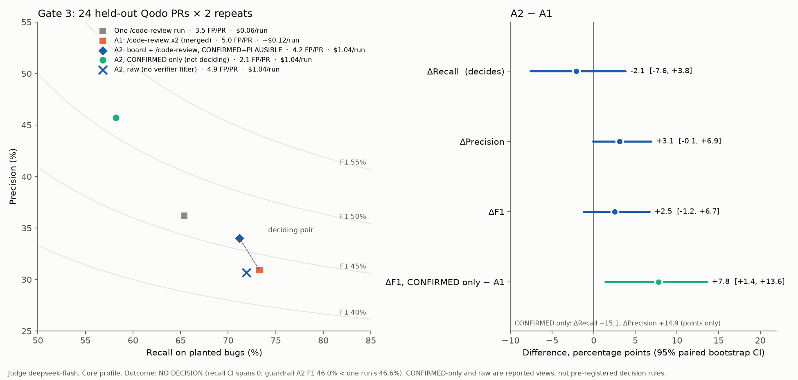
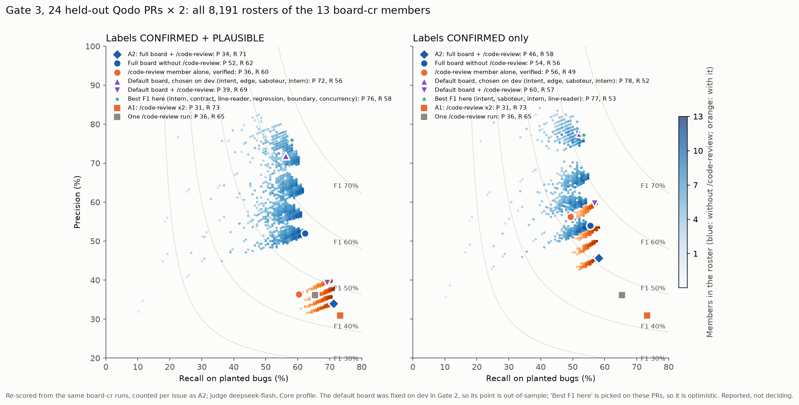

# Gate 3 on Qodo: deepseek-flash

Rule (PLAN Phase 3, Gate 3, agreed 2026-11-06 before any Gate 3 run or PR draw): Core-profile **recall** decides, A2 − A1, paired bootstrap over PRs (95% CI); A2's F1 must be at least one `/code-review` run's (guardrail).

- **A1**, `/code-review` ×2: two independent `/code-review` runs per repeat, merged (`code-review-x2`).
- **A2**, board + `/code-review` (`board-cr`): a `/code-review` session, then the full board with its findings as the 13th member `code-review` (`board-cr:full:cp:issues`).

24 PRs not used before (3 per repository from the Qodo test split, seed 20261107, `eval/datasets/qodo/gate3.json`), 2 repeats per variant: 96 A1 `/code-review` sessions and 48 `board-cr` runs, all `ok`, run on account B; judged by `deepseek-flash` on account A.

**Result: NO DECISION.** The recall CI spans 0, and the guardrail fails as well.

## Core profile (functional bugs, 73 golden issues)

| Variant | View | Runs | Precision | Recall | F1 |
|---|---|---|---|---|---|
| A2 | `board-cr:full:cp:issues` | 48 | 34.0% | 71.2% | 46.0% |
| A1 | `code-review-x2` | 48 | 30.9% | 73.3% | 43.5% |
| One `/code-review` run | `code-review:issues` | 96 | 36.2% | 65.4% | 46.6% |

| Paired bootstrap, A2 − A1 | Point | 95% CI | p |
|---|---|---|---|
| ΔRecall (decides) | −2.1 | −7.6 to +3.8 | 0.558 |
| ΔPrecision | +3.1 | −0.1 to +6.9 | 0.060 |
| ΔF1 | +2.5 | −1.2 to +6.7 | 0.181 |

Guardrail: A2's F1 46.0% is below one `/code-review` run's 46.6%.

## Reported, not deciding

**All profile** (with repository-rule violations): A2 41.3 / 53.8 / 46.7, A1 38.3 / 56.4 / 45.6, one run 44.4 / 50.8 / 47.3 (precision / recall / F1). ΔRecall −2.7 (−7.2 to +1.6), ΔF1 +1.1 (−2.3 to +4.6). Also NO DECISION.

**Cost and time per run.** A2 $1.04 and 4.1 minutes (both sessions); one `/code-review` session $0.06 and 0.9 minutes, so A1 about $0.12. A2 costs about 9 times as much. All Gate 3 runs: $55.45.

**The 13th member.** Without the `code-review` member, the board reaches 62.3% recall (52.0% precision), so the member adds 8.9 recall points. In 30 run-level hits across the 48 runs (all categories), the `code-review` member was the only one to find the golden issue.

**The verifier on `/code-review`'s findings.** 311 findings reached the board, all of them with their claims unchanged in 301. Labels: CONFIRMED 153 (100 match a golden issue), PLAUSIBLE 122 (25 match), REFUTED 36 (2 match). Wrongful refutations: 2 of 36 (5.6%); filtering lost 0.5 golden issues and removed 17 false positives (61.0% → 60.3% recall, 32.1% → 36.4% precision for the member alone).

**Label views of A2.** CONFIRMED only: 45.7 / 58.2 / 51.2; every finding before adjudication: 30.7 / 71.9 / 43.0. CONFIRMED only − A1: ΔF1 +7.8 (+1.4 to +13.6), ΔRecall −15.1, ΔPrecision +14.9.

## A2's `/code-review` sessions found less than A1's

The `code-review` member alone reaches 60.3% recall, below one native `/code-review` run's 65.4%. The board does not cause this:

- The 48 sessions inside `board-cr`, judged as native `/code-review` runs (diagnostic records, not used by the gate): 61.0% recall, 32.2% precision. As the board's member, before the verifier: 61.0% and 32.1%. Run by run, both judgings match the same golden issues, except one style issue the board's rewording matched.
- These sessions ran the same command as A1's (model, effort, plugin, config hash, Claude Code version, account).
- Against A1's sessions: −4.5 recall points (95% CI −8.5 to −0.4), spread over 7 PRs by about half an issue each. Single repeats of `/code-review` range from 60.3% to 68.5%; A1's repeat 2 (61.6%) is as low as A2's two.

So A2's `/code-review` input was a weak draw, probably worth a few recall points against A1. The check was made after the result, and its CI barely excludes 0. The gate's result stands. The same session also changed between tries: `ghost-7` A2 r2 reported no findings twice, then 3 (Yi's note from the runs).

## Rosters

All 8,191 rosters of the 13 members, re-scored from the same `board-cr` runs and counted per issue as A2. Picked on these PRs, so the best roster is optimistic; the default board was fixed on development PRs in Gate 2, so its point is out of sample.

| Roster (CONFIRMED + PLAUSIBLE) | Precision | Recall | F1 |
|---|---|---|---|
| Full board + `code-review` (A2) | 34.0% | 71.2% | 46.0% |
| Full board without `code-review` | 52.0% | 62.3% | 56.7% |
| Default board (intent, edge, saboteur, intern) | 71.9% | 56.2% | 63.1% |
| Default board + `code-review` | 39.3% | 69.2% | 50.1% |
| `code-review` member alone | 36.4% | 60.3% | 45.4% |
| Best F1 here (intern, contract, line-reader, regression, boundary, concurrency) | 75.9% | 58.2% | 65.9% |

- Every roster with the `code-review` member is below about 40% precision: it brings most of the board's false positives.
- About 8 members reach the full board's recall; contract, edge, regression, boundary, and concurrency add none on these PRs.

## Runs

Run fixes were decided after the runs and before any scoring (PLAN, Gate 3, "Run fixes"): the empty-`ReportFindings` rule (#42), with A2 `firefox_ios-2` r1 and `aspnetcore-10` r1 rerun and A1 `redis-4` r3 re-scored; an empty extra member for a finished session without findings (#43), whose `ghost-7` A2 r2 rerun then came back with 3 findings (`parsed: true`); and ten A1 usage-limit reruns (#41). `permission_denials` was 21 across A1's sessions and 23 across A2's runs; no member failed. Judging made 3,588 new calls with no failed run; it paused once for a busy endpoint and resumed.

## For the decision

Gate 3 does not show that the members add recall on top of a second `/code-review` sample, at about 9 times the cost. What the data shows instead is a precision trade:

- The verifier's labels and the roster move the board along a precision–recall path; neither moves it to higher recall than `/code-review` ×2.
- If the next stage lets an agent revise code from the findings, false positives cost edits. Per PR, A1 reports about 5.0 false positives, A2 4.2, A2 CONFIRMED only 2.1, and the default board about 0.7 (on about 3 golden issues per PR).
- A precision-aware claim needs a new pre-registered rule (for example recall at a precision floor, or false positives per PR) and PRs no gate has scored. A cheaper competitor belongs in it: `/code-review` with the fixing agent checking each finding before it edits.
