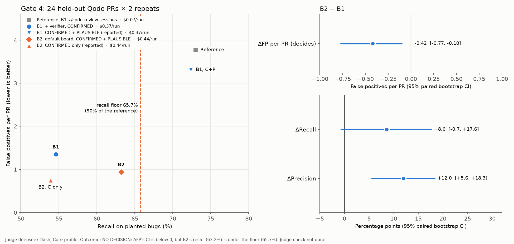

# Gate 4 on Qodo: deepseek-flash

Rule (PLAN Phase 3, Gate 4, agreed 2026-11-07 before any Gate 4 run or PR draw; views and command fixed in #47): Core-profile **false positives per PR** decide, B2 − B1, paired bootstrap over PRs (95% CI below 0 to win); B2's recall must be at least 90% of the recall of B1's `/code-review` sessions before the check (point estimates, guardrail). Counted per issue, as in Gate 3.

- **B1**, a checking step (`board-none`): a `/code-review` session, then the board with no members and the board's verifier over its findings, CONFIRMED kept (`board-none:full:confirmed:issues`).
- **B2**, the default board (`board-default`): a real `--members default` run (intent, edge, saboteur, intern), CONFIRMED + PLAUSIBLE kept (`board-default:full:cp:issues`).

24 PRs not used before (3 per repository from the Qodo test split, seed 20261108, `eval/datasets/qodo/gate4.json`), 2 repeats per variant: 96 runs, all `ok`, run on account B by Yara; judged by `deepseek-flash` on account A.

**Result: NO DECISION (the recall floor fails).** B2 has fewer false positives per PR than B1, but its recall is below the floor. Under the stop policy agreed with Gate 4, the board project stops here; there is no Gate 5.

## Core profile (functional bugs, 76 golden issues)

| Variant | View | Runs | Precision | Recall | FP per PR |
|---|---|---|---|---|---|
| B2 | `board-default:full:cp:issues` | 48 | 68.1% | 63.2% | 0.94 |
| B1 | `board-none:full:confirmed:issues` | 48 | 56.1% | 54.6% | 1.35 |
| Floor reference: B1's `/code-review` sessions | `code-review-b1:issues` | 48 | 38.0% | 73.0% | 3.77 |

| Paired bootstrap, B2 − B1 | Point | 95% CI | p |
|---|---|---|---|
| ΔFP per PR (decides) | −0.42 | −0.77 to −0.10 | 0.014 |
| ΔRecall | +8.6 | −0.7 to +17.6 | 0.078 |
| ΔPrecision | +12.0 | +5.6 to +18.3 | 0.000 |

Recall floor: B2's 63.2% is below 90% of 73.0%, which is 65.7%. B2 reached 87% of the reference.

## Reported, not deciding

| Variant | View | Precision | Recall | FP per PR |
|---|---|---|---|---|
| B1, CONFIRMED + PLAUSIBLE | `board-none:full:cp:issues` | 40.9% | 72.4% | 3.31 |
| B2, CONFIRMED only | `board-default:full:confirmed:issues` | 69.5% | 53.9% | 0.75 |

## Runs

- **Cost:** B1 $17.93 for 48 runs ($0.37 each: about $0.07 for the `/code-review` session and $0.30 for the verifier pass), B2 $21.35 ($0.44 each).
- **Format slips:** 4 of 48 B2 runs, none of B1's, ended with a malformed report (PLAN Gate 4, decided before scoring). `cal_com-8` r1 wrote markdown and was rerun; three runs had their findings in the wrong place in valid JSON and were normalized in scoring (#48). A user would have got a broken report each time.
- **Permission denials:** 10, all in B1's `/code-review` sessions (compound `cd ...;` commands and one blocked `git checkout`), as in Gate 3. B2 had none.
- **Judging:** 144 records (the 48 nested `/code-review` sessions judged alone as the floor's reference), one served judge fingerprint, no failed runs, no dedup fallbacks. The pipeline check (complete records, fresh sources, one candidate per board finding, every view scoring every record) passed.

## Judge check: not done

PLAN asks for Jim's 60-pair blind check of the judge. The sheet was drawn (15 pairs per variant and verdict, Core bugs, full texts and a short version) but **not labeled**: Jim closed Gate 4 without it (2026-11-08), as the board would not be pursued whatever the check showed. The result above therefore rests on the judge alone. The floor was missed by 2.5 points, a margin a few wrong match calls could cover, so the board's recall is best read as close to, not clearly below, the floor.

## For the decision

Four gates have not shown that the board beats native `/code-review` under the rules set before each run. What Gate 4 did show is where the board's precision comes from: an issue found by two or more of its members is about 85% precise, while one found by a single member is about 12% (exploratory, PLAN v2). That is agreement between independent reviews, which `/code-review` run more than once can also provide. PLAN v2 takes that up.
