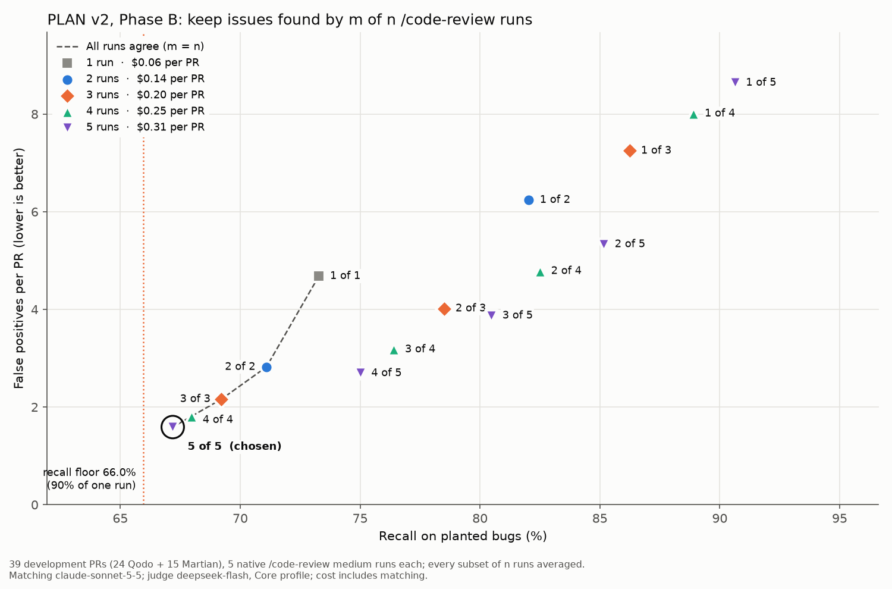
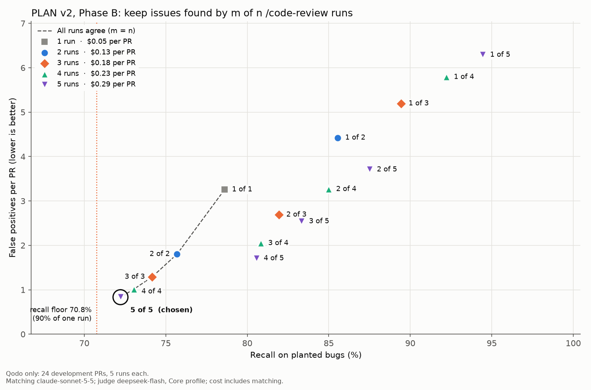
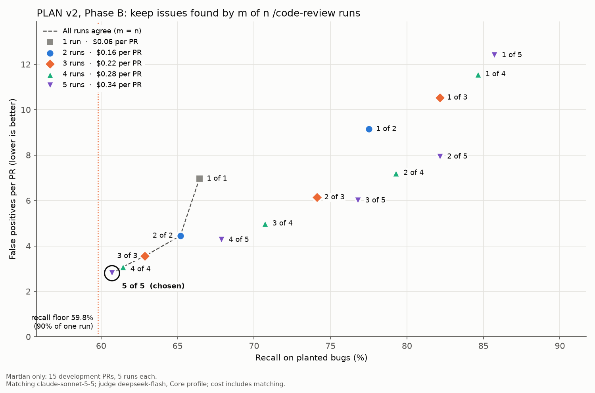

# PLAN v2, Phase B: how many runs (question 1)

**Result: keep the issues found by all 5 of 5 runs.** Against one native run, it cuts false positives per PR from 4.68 to 1.59 (−3.09, 95% CI −3.60 to −2.56) and keeps 92% of one run's recall (67.2% against 73.3%). It is the configuration PLAN-v2's selection rule picks, pooled and in each dataset alone. The add-on is frozen with it (PLAN-v2, Phase B, Output).

- **PRs:** the 39 development PRs, 24 Qodo and 15 Martian. No test PR.
- **Runs:** native `/code-review medium --max-findings all`, Claude Code 2.1.317, `claude-sonnet-5-5`, session effort `medium`, account B. 5 runs per PR, 195 in all, every one `ok`: 68 reused from earlier work, 127 new (Y12, $6.78).
- **Matching:** the add-on's own step, one `claude-sonnet-5-5` call per PR over its 5 runs (effort `medium`, `MATCH_PROMPT` sha256 `d8e289503446…`), $0.029 per PR on average. A smaller n uses the same groups, restricted to its runs. The judge's dedup is not used.
- **Scoring:** judge `deepseek-flash`, Core profile, per issue: a kept issue counts once, as found if any of its findings matches a golden comment. Every subset of n runs is scored and averaged; the bootstrap pairs over PRs (2,000 draws, seed 20261109). Cost per PR is n runs plus the matching step for n ≥ 2.
- **Selection rule (fixed before scoring):** recall at least 90% of one run's (point estimate); among those, the fewest false positives per PR; then the fewest runs within one bootstrap SE of it.

## Pooled: 39 PRs

| Keep issues found by | Precision | Recall | FP per PR | ΔFP vs one run (95% CI) | Recall vs one run | Cost per PR |
|---|---|---|---|---|---|---|
| 1 of 1 | 33.9% | 73.3% | 4.68 |  | 100% | $0.06 |
| 1 of 2 | 30.1% | 82.0% | 6.24 | +1.56 (+1.25 to +1.88) | 112% | $0.14 |
| 2 of 2 | 45.3% | 71.1% | 2.82 | -1.86 (-2.17 to -1.55) | 97% | $0.14 |
| 1 of 3 | 28.1% | 86.2% | 7.25 | +2.57 (+2.07 to +3.09) | 118% | $0.20 |
| 2 of 3 | 39.1% | 78.5% | 4.02 | -0.66 (-0.89 to -0.46) | 107% | $0.20 |
| 3 of 3 | 51.2% | 69.2% | 2.16 | -2.52 (-2.93 to -2.09) | 94% | $0.20 |
| 1 of 4 | 26.7% | 88.9% | 8.01 | +3.33 (+2.68 to +4.02) | 121% | $0.25 |
| 2 of 4 | 36.1% | 82.5% | 4.78 | +0.10 (-0.16 to +0.36) | 113% | $0.25 |
| 3 of 4 | 44.1% | 76.4% | 3.18 | -1.50 (-1.82 to -1.21) | 104% | $0.25 |
| 4 of 4 | 55.2% | 68.0% | 1.81 | -2.87 (-3.35 to -2.37) | 93% | $0.25 |
| 1 of 5 | 25.6% | 90.6% | 8.64 | +3.96 (+3.19 to +4.80) | 124% | $0.31 |
| 2 of 5 | 34.4% | 85.2% | 5.33 | +0.65 (+0.31 to +1.01) | 116% | $0.31 |
| 3 of 5 | 40.6% | 80.5% | 3.87 | -0.81 (-1.12 to -0.52) | 110% | $0.31 |
| 4 of 5 | 47.8% | 75.0% | 2.69 | -1.99 (-2.40 to -1.58) | 102% | $0.31 |
| 5 of 5 **(chosen)** | 58.1% | 67.2% | 1.59 | -3.09 (-3.60 to -2.56) | 92% | $0.31 |

Recall floor 66.0%. Fewest false positives per PR above it: 5 of 5. Chosen: 5 of 5.

## Qodo alone: 24 PRs

| Keep issues found by | Precision | Recall | FP per PR | ΔFP vs one run (95% CI) | Recall vs one run | Cost per PR |
|---|---|---|---|---|---|---|
| 1 of 1 | 42.0% | 78.6% | 3.26 |  | 100% | $0.05 |
| 1 of 2 | 36.7% | 85.6% | 4.42 | +1.17 (+0.84 to +1.51) | 109% | $0.13 |
| 2 of 2 | 55.7% | 75.7% | 1.80 | -1.45 (-1.77 to -1.15) | 96% | $0.13 |
| 1 of 3 | 34.1% | 89.4% | 5.20 | +1.94 (+1.39 to +2.50) | 114% | $0.18 |
| 2 of 3 | 47.7% | 81.9% | 2.69 | -0.57 (-0.82 to -0.33) | 104% | $0.18 |
| 3 of 3 | 63.3% | 74.2% | 1.29 | -1.97 (-2.39 to -1.54) | 94% | $0.18 |
| 1 of 4 | 32.3% | 92.2% | 5.79 | +2.53 (+1.81 to +3.27) | 117% | $0.23 |
| 2 of 4 | 43.8% | 85.0% | 3.27 | +0.01 (-0.26 to +0.26) | 108% | $0.23 |
| 3 of 4 | 54.2% | 80.8% | 2.05 | -1.21 (-1.59 to -0.84) | 103% | $0.23 |
| 4 of 4 | 68.3% | 73.1% | 1.02 | -2.24 (-2.73 to -1.75) | 93% | $0.23 |
| 1 of 5 | 31.1% | 94.4% | 6.29 | +3.03 (+2.18 to +3.92) | 120% | $0.29 |
| 2 of 5 | 41.4% | 87.5% | 3.71 | +0.45 (+0.09 to +0.80) | 111% | $0.29 |
| 3 of 5 | 49.6% | 83.3% | 2.54 | -0.72 (-1.08 to -0.39) | 106% | $0.29 |
| 4 of 5 | 58.6% | 80.6% | 1.71 | -1.55 (-2.03 to -1.10) | 102% | $0.29 |
| 5 of 5 **(chosen)** | 72.2% | 72.2% | 0.83 | -2.42 (-2.96 to -1.88) | 92% | $0.29 |

Recall floor 70.8%. Fewest false positives per PR above it: 5 of 5. Chosen: 5 of 5.

## Martian alone: 15 PRs

| Keep issues found by | Precision | Recall | FP per PR | ΔFP vs one run (95% CI) | Recall vs one run | Cost per PR |
|---|---|---|---|---|---|---|
| 1 of 1 | 26.3% | 66.4% | 6.96 |  | 100% | $0.06 |
| 1 of 2 | 24.0% | 77.5% | 9.15 | +2.19 (+1.72 to +2.64) | 117% | $0.16 |
| 2 of 2 | 35.4% | 65.2% | 4.45 | -2.51 (-3.00 to -2.01) | 98% | $0.16 |
| 1 of 3 | 22.5% | 82.1% | 10.53 | +3.57 (+2.83 to +4.31) | 124% | $0.22 |
| 2 of 3 | 31.1% | 74.1% | 6.14 | -0.82 (-1.21 to -0.47) | 112% | $0.22 |
| 3 of 3 | 39.8% | 62.9% | 3.55 | -3.41 (-4.05 to -2.69) | 95% | $0.22 |
| 1 of 4 | 21.5% | 84.6% | 11.56 | +4.60 (+3.61 to +5.57) | 127% | $0.28 |
| 2 of 4 | 29.1% | 79.3% | 7.21 | +0.25 (-0.23 to +0.80) | 119% | $0.28 |
| 3 of 4 | 34.6% | 70.7% | 4.99 | -1.97 (-2.47 to -1.49) | 106% | $0.28 |
| 4 of 4 | 42.7% | 61.4% | 3.08 | -3.88 (-4.64 to -3.04) | 92% | $0.28 |
| 1 of 5 | 20.5% | 85.7% | 12.40 | +5.44 (+4.21 to +6.67) | 129% | $0.34 |
| 2 of 5 | 27.9% | 82.1% | 7.93 | +0.97 (+0.43 to +1.65) | 124% | $0.34 |
| 3 of 5 | 32.3% | 76.8% | 6.00 | -0.96 (-1.55 to -0.41) | 116% | $0.34 |
| 4 of 5 | 37.3% | 67.9% | 4.27 | -2.69 (-3.39 to -2.05) | 102% | $0.34 |
| 5 of 5 **(chosen)** | 44.7% | 60.7% | 2.80 | -4.16 (-4.97 to -3.27) | 91% | $0.34 |

Recall floor 59.8%. Fewest false positives per PR above it: 5 of 5. Chosen: 5 of 5.

## Reading

- **Unanimity is best at every n, and the selection rule picks the largest n.** False positives per PR fall with each run that must agree: 4.68, 2.82, 2.16, 1.81, 1.59. The steps shrink (−1.86, −0.66, −0.35, −0.22) but 4 of 4 is not within one SE of 5 of 5.
- **Majority rules buy recall with false positives.** 3 of 5 has 110% of one run's recall but 3.87 false positives per PR; 2 of 5 is worse than one run on false positives.
- **Recall falls slowly with n under unanimity**, from 73.3% (one run) to 67.2% (5 of 5). In Phase A it held or rose, because Phase A matched findings with the judge's dedup; the add-on's own matcher joins fewer findings, so each extra run removes a little recall.

## Caveats

- **5 of 5 is close to the recall floor:** 1.2 points above it pooled, 1.4 on Qodo, 0.9 on Martian. Phase C requires the add-on's recall to be at least 90% of native in each mode on new PRs, so it can fail on recall as well as on false positives.
- **The matching step is not checked on its own** (PLAN-v2, Phase B): its errors count only through the false positives and recall above.
- **Development PRs:** these PRs shaped earlier work, and the selection is made on them. Phase C, on unused test PRs, is the confirmation.
- **One mode only:** every run here is at `medium`.
