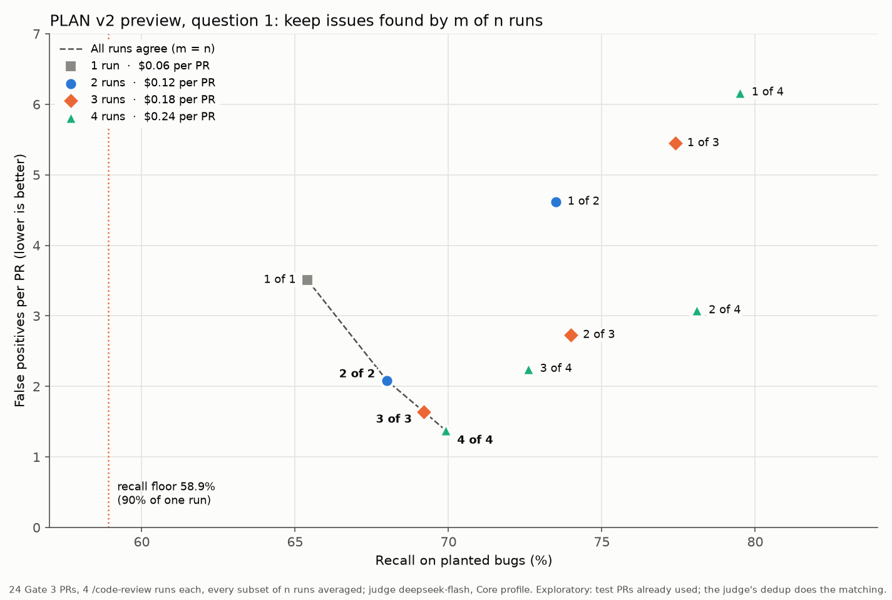
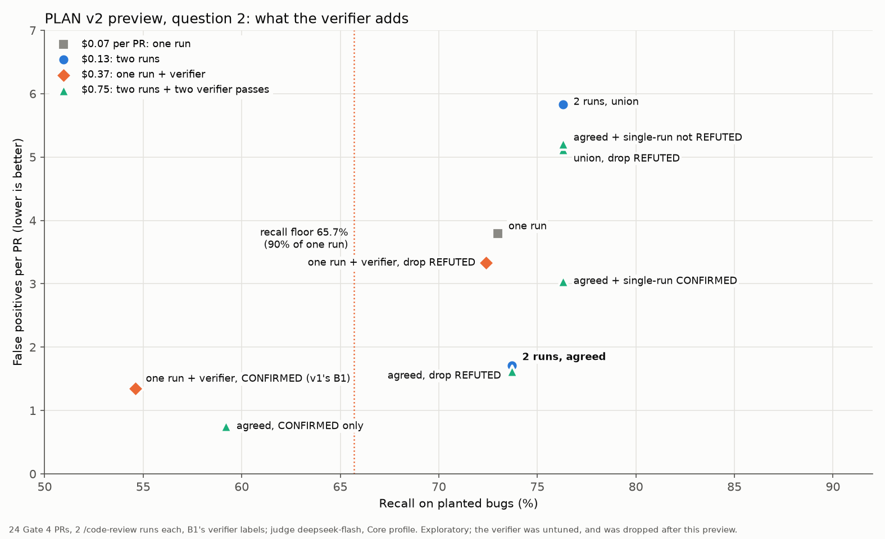

# PLAN v2, Phase A: preview of questions 1 and 2

Exploratory, re-scored from existing runs, no new review runs. It shapes Phase B and decides nothing (PLAN-v2 5).

- **Runs:** native `/code-review medium --max-findings all`, as in v1.
  - Question 1: the 4 A1 runs on each of Gate 3's 24 PRs.
  - Question 2: the 2 `/code-review` sessions inside B1 on each of Gate 4's 24 PRs, with B1's verifier labels on each.
- **Scoring:** Core profile, per issue, `deepseek-flash`, the judge's existing match verdicts.
- **Agreement:** two findings agree when the judge's dedup puts them in one issue. Four runs are too many for one dedup call (the endpoint times out), so every pair of runs was deduped and linked findings form one issue (connected components). New dedup calls ran on account A; the three that fell back were rerun, and none fell back the second time.
- **Every subset of n runs** is scored and averaged; the bootstrap pairs over PRs (2,000 draws, seed 20261108).

## Caveats

- These are test PRs Gates 3 and 4 already used (logged in `test-split-log.md`); none of it can be confirmatory.
- The judge's dedup is not the add-on's matching step. It is likely better, so agreement here is an upper bound. Chaining pairs into components can also join two distinct issues, which flatters agreement at n = 3 and 4.
- A kept issue counts as found when any of its findings matches a golden issue, so the add-on must report the issue's best wording (or all of them) to reach this recall. That is why recall can rise as m goes up.
- Questions 1 and 2 use different PRs; `2 of 2` appears in both (2.08 and 1.71 FP per PR).

## Question 1: m of n runs (Gate 3 PRs)

One run costs $0.059 on average.

| Keep issues found by | Precision | Recall | FP per PR | Cost per PR |
|---|---|---|---|---|
| 1 of 1 (native) | 36.2% | 65.4% | 3.51 | $0.06 |
| 1 of 2 | 32.6% | 73.5% | 4.62 | $0.12 |
| 2 of 2 | 49.8% | 68.0% | 2.08 | $0.12 |
| 1 of 3 | 30.2% | 77.4% | 5.45 | $0.18 |
| 2 of 3 | 45.2% | 74.0% | 2.73 | $0.18 |
| 3 of 3 | 56.3% | 69.2% | 1.64 | $0.18 |
| 1 of 4 | 28.2% | 79.5% | 6.17 | $0.24 |
| 2 of 4 | 43.5% | 78.1% | 3.08 | $0.24 |
| 3 of 4 | 49.5% | 72.6% | 2.25 | $0.24 |
| 4 of 4 | 60.7% | 69.9% | 1.38 | $0.24 |

Paired bootstrap against one run:

| Rule | ΔFP per PR (95% CI) | SE | ΔRecall (95% CI) | Recall vs one run |
|---|---|---|---|---|
| 1 of 2 | +1.11 (+0.84 to +1.40) | 0.14 | +8.1 (+5.3 to +10.9) | 112% |
| 2 of 2 | −1.43 (−1.67 to −1.19) | 0.12 | +2.6 (−0.5 to +5.7) | 104% |
| 2 of 3 | −0.78 (−1.04 to −0.52) | 0.13 | +8.6 (+5.2 to +12.2) | 113% |
| 3 of 3 | −1.87 (−2.22 to −1.55) | 0.17 | +3.8 (−1.3 to +8.8) | 106% |
| 2 of 4 | −0.43 (−0.74 to −0.06) | 0.17 | +12.7 (+7.8 to +17.7) | 119% |
| 3 of 4 | −1.26 (−1.58 to −0.95) | 0.16 | +7.2 (+1.7 to +12.5) | 111% |

**Reading:**
- Unanimity (m = n) is best at every n, and it keeps one run's recall.
- False positives per PR fall from 3.51 (one run) to 2.08 (2 of 2), 1.64 (3 of 3) and 1.38 (4 of 4). Each extra run helps less: −1.43, then −0.44, then −0.26.
- Majority rules (2 of 3, 2 or 3 of 4) trade the precision for recall.
- Runs are cheap: four cost $0.24 per PR. The curve has not flattened at n = 4, so Phase B's k = 5 is needed to find where it does.

## Question 2: the verifier's role (Gate 4 PRs, 2 runs)

One run costs $0.066; one verifier pass over a run's findings $0.307, about 4.7 runs.

| Strategy | Precision | Recall | FP per PR | Cost per PR |
|---|---|---|---|---|
| one run (native) | 37.9% | 73.0% | 3.79 | $0.07 |
| one run + verifier, CONFIRMED only (v1's B1) | 56.1% | 54.6% | 1.35 | $0.37 |
| one run + verifier, drop REFUTED | 40.7% | 72.4% | 3.33 | $0.37 |
| 2 runs, union | 29.3% | 76.3% | 5.83 | $0.13 |
| 2 runs, union, drop REFUTED | 32.0% | 76.3% | 5.12 | $0.75 |
| **2 runs, agreed** | **57.7%** | **73.7%** | **1.71** | **$0.13** |
| (a) agreed, drop REFUTED | 58.9% | 73.7% | 1.62 | $0.75 |
| (a) agreed, CONFIRMED only | 71.4% | 59.2% | 0.75 | $0.75 |
| (b) agreed + single-run CONFIRMED | 44.3% | 76.3% | 3.04 | $0.75 |
| (b) agreed + single-run not REFUTED | 31.7% | 76.3% | 5.21 | $0.75 |

The verifier's cost is a full pass over every finding of both runs; a pass over the agreed issues only would cost less.

Paired bootstrap against `2 runs, agreed`:

| Strategy | ΔFP per PR (95% CI) | ΔRecall (95% CI) |
|---|---|---|
| one run | +2.08 (+1.58 to +2.60) | −0.7 (−3.6 to +2.5) |
| one run + verifier, CONFIRMED only (B1) | −0.35 (−0.85 to +0.15) | −19.1 (−30.1 to −9.0) |
| 2 runs, union | +4.12 (+3.12 to +5.17) | +2.6 (0.0 to +6.9) |
| (a) agreed, drop REFUTED | −0.08 (−0.21 to 0.00) | 0.0 |
| (a) agreed, CONFIRMED only | −0.96 (−1.25 to −0.63) | −14.5 (−24.7 to −5.7) |
| (b) agreed + single-run CONFIRMED | +1.33 (+0.79 to +2.00) | +2.6 (0.0 to +6.7) |
| (b) agreed + single-run not REFUTED | +3.50 (+2.54 to +4.54) | +2.6 (0.0 to +6.8) |

**Reading:**
- **Two agreeing runs match the verifier's precision at a third of its cost, with all of one run's recall.** v1's B1 (one run + verifier) had 1.35 FP per PR but lost 18 recall points; `2 runs, agreed` has 1.71 and loses none.
- **(a) Filtering agreed issues:** dropping REFUTED removes almost nothing (−0.08). Keeping only CONFIRMED halves the false positives again but costs 14.5 recall points, below a 90% floor (59.2% against 65.7%).
- **(b) Rescuing single-run issues** brings back 2.6 recall points for 1.3 to 3.5 more false positives per PR. Not worth it.
- **(c) Cost-matched alternative:** a verifier pass costs about as much as 4–5 runs. In question 1, adding runs lowers false positives without losing recall; the verifier does not.

## Preview answer

- **Question 1:** keep issues found by all n runs; n is at least 3, chosen in Phase B from k = 5 runs.
- **Question 2:** with the current verifier, none of its roles beats more runs at the same cost. Only role (a) with CONFIRMED only goes further on false positives, and it fails the recall floor. Phase B keeps role (a) as the one verifier candidate, run on the agreed issues only, where it is cheapest; it is kept only by PLAN-v2's selection rule.

**Decided after this preview (Jim, 2026-11-09):** the verifier is abandoned, replaced by intersections of `/code-review` runs. Phase B does not run it.

Scripts (`preview_merge.py`, `preview_analysis.py`) were run from a scratch directory on 2026-11-08–09 and are not part of the repository.
